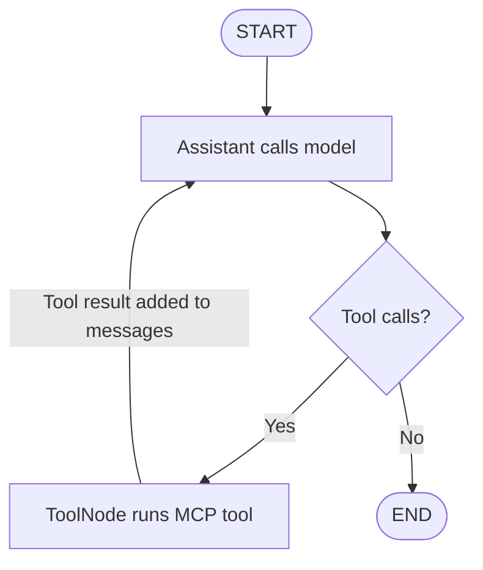
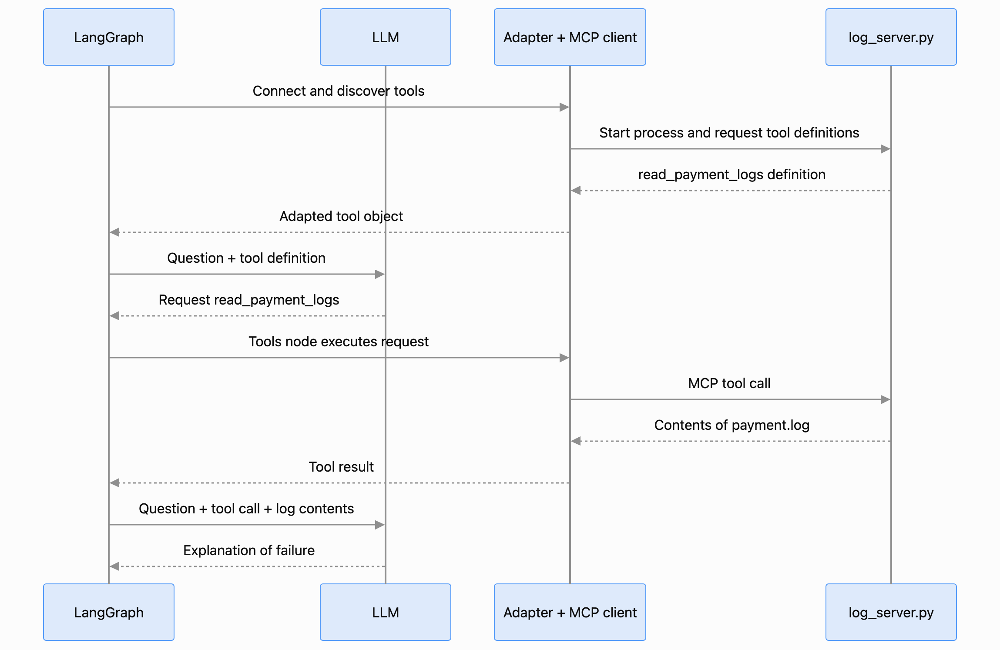

# MCP + LangGraph log investigation

A small learning demo: an agent uses an MCP tool to read payment logs, then explains the failure. LangGraph controls the conversation and tool execution.

## Files

- `agent.py`: connects to MCP, configures the model, and runs the graph.
- `log_server.py`: exposes `read_payment_logs` through a FastMCP server.
- `payment.log`: sample logs reporting a missing `DATABASE_URL`.

## Setup and run

Use Python 3.12 (the version verified for this project).

```bash
python3.12 -m venv .venv
source .venv/bin/activate
python -m pip install -r requirements.txt

export CHAT_MODEL="openai:gpt-4.1-mini"
export OPENAI_API_KEY="your-api-key"
python agent.py
```

Choose a tool-capable model available to your account. The agent starts the MCP server automatically as a subprocess over stdio; there is no separate server command to run.

Expected flow: discover `read_payment_logs`, request the tool, read its result, and explain that the sample application failed because `DATABASE_URL` was missing. This diagnosis comes from the sample log; the demo itself does not connect to a database. The FastMCP startup banner and LangChain beta warning are informational.

## Imports and their roles

```python
import asyncio
import os
from pathlib import Path

from langchain.chat_models import init_chat_model
from langchain.messages import SystemMessage
from langchain.mcp import MCPAdapter
from langgraph.graph import END, START, MessagesState, StateGraph
from langgraph.prebuilt import ToolNode
```

| Import | Role in this demo |
| --- | --- |
| `asyncio` | Runs the asynchronous program with `asyncio.run(main())`. |
| `os` | Reads `CHAT_MODEL` from the environment. |
| `Path` | Locates `log_server.py` beside the agent script. |
| `init_chat_model` | Creates the chat model from its provider and model name. |
| `SystemMessage` | Instructs the model to read the logs before diagnosing. |
| `MCPAdapter` | Connects to the MCP server and adapts its discovered tools into LangChain tools. |
| `StateGraph` | Builds the workflow from nodes and routes. |
| `MessagesState` | Holds the conversation, accumulating model messages and tool results. |
| `START`, `END` | Mark the graph's entry and exit. |
| `ToolNode` | Executes the model's requested tools and adds their results to the conversation. |

## My understanding of the workflow

1. `log_server.py` exposes `read_payment_logs`.
2. `MCPAdapter` starts the server and discovers the tool.
3. `model.bind_tools(tools)` tells the model which tools it can request.
4. The assistant node sends the instructions and conversation to the model.
5. If the response contains tool calls, the graph routes to `ToolNode`. The adapted tool sends the request through MCP, and the server reads `payment.log`.
6. The graph loops back to the assistant with the tool result. When the model responds without tool calls, the graph ends.

**The model requests a tool; `ToolNode` executes it through the adapter.** Binding tools makes them available to the model; it does not execute them.



### Sequence diagram



The diagram's LangGraph lane represents the orchestration code in `agent.py`, including initial tool discovery before the compiled graph runs. The LLM receives tool definitions and results; the server performs the actual log read.

## References

- [LangGraph: nodes, edges, and shared state](https://docs.langchain.com/oss/python/langgraph/thinking-in-graph-api)
- [LangChain MCP integration and MCPAdapter](https://www.langchain.com/blog/mcp-in-langchain-stateless-protocol-elicitation-and-more)

The repository name is `mcp_langgraph`.
